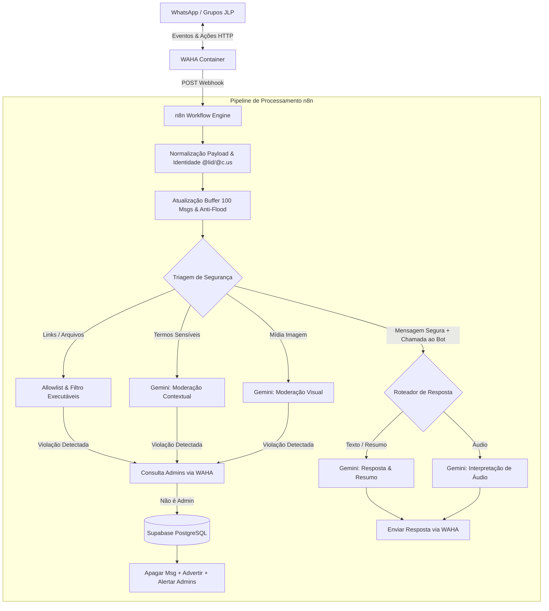

<div align="center">

# `// Harpy AI — Assistente Conversacional e Moderador Automatizado (JLP)`

<a href="https://git.io/typing-svg">
  
</a>

</div>

<br/>

```bash
Harpy-AI@JLP-Core:~$ cat system_overview.log
> SISTEMA:    Harpy AI — Assistente Conversacional e Moderador Automatizado (JLP)
> COMUNIDADE: Jovens Latinos na Política (JLP) // ~500 membros (Brasil, Argentina, França)
> PIPELINE:   Orquestração orientada a eventos + NLP + Visão Computacional +
>             Transcrição de Áudio + Persistência Relacional em tempo real.
```

---

### `// 01. CONTEXTO & PROBLEMA RESOLVIDO`

Comunidades políticas e cívicas abertas enfrentam desafios operacionais recorrentes no WhatsApp:

* **`▸ Sobrecarga de Moderação Manual:`** Dificuldade para identificar rapidamente spam, links maliciosos, arquivos executáveis, conteúdo visual impróprio e ataques pessoais em meio a alto volume de mensagens.
* **`▸ Falsos Positivos na Moderação Política:`** Filtros tradicionais baseados apenas em palavras-chave bloqueiam debates legítimos, notícias e críticas dirigidas a figuras públicas externas.
* **`▸ Dispersão de Informações:`** Novos membros frequentemente solicitam links oficiais, estatuto e resumos de discussões anteriores.
* **`▸ Rastreabilidade de Reincidência:`** Falta de histórico estruturado de infrações por participante para aplicação progressiva e transparente das regras da comunidade.

> **Solução:** O **Harpy AI** automatiza a triagem de segurança em múltiplos estágios, mantém histórico persistente de ocorrências e atua como assistente sob demanda para dúvidas e resumos da comunidade.

---

### `// 02. FUNCIONALIDADES IMPLEMENTADAS`

#### `> 🛡️ MODERAÇÃO AUTOMATIZADA EM CAMADAS`
* **Allowlist e Controle de Links/Arquivos:** Validação determinística em JavaScript que libera domínios confiáveis (portais governamentais `.gov.br`, `.leg.br`, `.jus.br`, veículos de imprensa, YouTube, TikTok e X) e bloqueia encurtadores suspeitos, convites externos não autorizados e arquivos executáveis/perigosos.
* **Moderação Contextual de Texto com IA:** Triagem prévia por normalização léxica (remoção de acentos, espaços artificiais e *leetspeak*) combinada com análise contextual via Google Gemini (`gemini-3.5-flash-lite`) utilizando janela recente de mensagens (`recent15Messages`). Diferencia críticas políticas externas (permitidas) de ataques direcionados a membros, discurso de ódio ou ameaças reais.
* **Moderação Visual (Visão Computacional):** Inspeção automatizada de imagens enviadas nos grupos para detecção de conteúdo +18, drogas ilícitas, armas de fogo, violência explícita ou discurso de ódio.
* **Sistema Progressivo de Advertências e Escalonamento:**
  * *1ª ocorrência:* Remoção da mensagem e aviso educativo no grupo (sem strike formal).
  * *Reincidência (1/3 a 3/3) ou infrações graves (Níveis 4/5):* Registro no banco de dados, notificação estruturada em grupo exclusivo de administradores e encaminhamento para revisão humana/ação administrativa.
* **Isenção de Administradores e Resolução de Identidade (`@lid` / `@c.us`):** Cruzamento dinâmico com a lista de participantes via API do WAHA para identificar administradores do grupo e mapear identificadores internos de privacidade (`@lid`) para números no padrão E.164.

#### `> 💬 ASSISTÊNCIA MULTIMODAL & CONTROLE DE INTERAÇÃO`
* **Atendimento Sob Demanda:** Responde no privado ou em grupos quando mencionado (`@Harpy`), chamado pelo nome ou em resposta direta a mensagens do bot.
* **Buffer de Contexto e Resumo de Conversas:** Armazenamento em memória de janela deslizante (até 100 mensagens por grupo) para geração de resumos sob demanda.
* **Compreensão de Áudio:** Download e transcrição/interpretação de mensagens de voz via API multimodal do Gemini.
* **Controle Individual de Silêncio (Opt-out):** Cada usuário pode pausar (`"Harpy, parar"`) ou reativar (`"Harpy, voltar"`) as respostas do assistente individualmente sem afetar os demais participantes.

---

### `// 03. STACK & ARQUITETURA DE TECNOLOGIAS`

<p align="center">
  
  
  
  
  
  
</p>

| Camada | Tecnologia / Ferramenta | Papel no Projeto |
| :--- | :--- | :--- |
| **Gateway WhatsApp** | WAHA (WhatsApp HTTP API) | Recebimento de eventos via Webhook, consulta de metadados/admins de grupos, download de mídia e envio/remoção de mensagens. |
| **Orquestração** | n8n (Self-hosted) | Motor de automação visual e lógico que coordena webhooks, regras de negócio, chamadas de IA e consultas SQL. |
| **Lógica Customizada** | JavaScript (Nodes `Code` no n8n) | Normalização de texto anti-evasão, parse de payloads (`@lid`/`@c.us`), allowlist de URLs, buffer de mensagens e regras de reincidência. |
| **Inteligência Artificial** | Google Gemini API (`gemini-3.5-flash-lite`) | Classificação contextual de texto, moderação de imagens, transcrição de áudio e geração de respostas/resumos. |
| **Banco de Dados** | PostgreSQL (hospedado no Supabase) | Persistência relacional de participantes, histórico de infrações (idempotente por `message_id`) e base de conhecimento. |
| **Infraestrutura** | Docker + AWS Lightsail (Linux) | Conteinerização dos serviços (`n8n` e `waha`) em rede interna isolada em instância cloud. |

---

### `// 04. FLUXO DE PROCESSAMENTO & PIPELINE`



---

<div align="center">

`Harpy-AI@JLP-Core:~$ connect --live-env`

<a href="https://jovenslatinosnapolitica.netlify.app/" target="_blank"></a>
<a href="https://wa.me/558183848339" target="_blank"></a>
<a href="https://github.com/CodeByWesley"></a>

</div>
